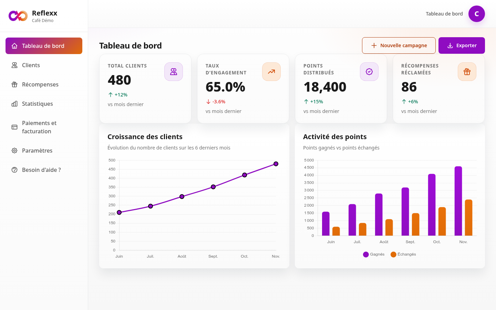
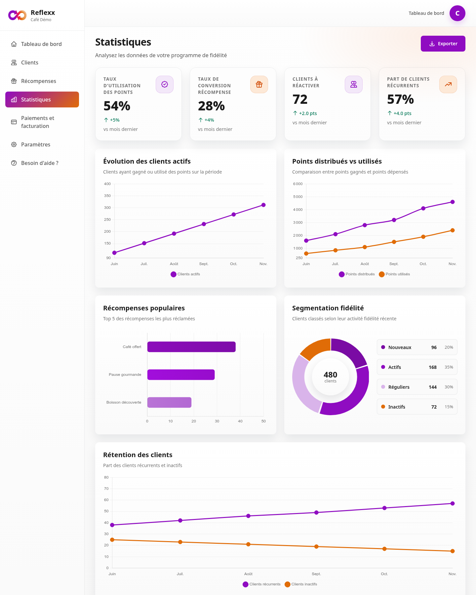

# Bonjour, je suis Philippe.

[English](README.md) · [Portfolio](https://www.webbyphil.net/) · [LinkedIn](https://www.linkedin.com/in/philippe-le-goff-35a12319a/) · [Email](mailto:webbyphil65@gmail.com)

Développeur full-stack basé à **Lyon**, avec plus de deux ans d’expérience professionnelle en développement logiciel. J’aime construire des produits utiles, comprendre les systèmes et partager mes connaissances avec une équipe.

Mon socle est **TypeScript, React, Node.js et MongoDB**. J’aime intégrer l’IA lorsque cela sert un usage concret : traiter des documents, retrouver une information, analyser un récit ou préparer un travail à valider par une personne.

## Projet principal : Reflexx

**Une plateforme de fidélité entre web, mobile et API.**

Je co-développe Reflexx avec deux autres ingénieurs et je coordonne sa feuille de route technique. Les interfaces Angular et Flutter se connectent à une API TypeScript/Express, adossée à Prisma et PostgreSQL, pour gérer les programmes commerçants, les points et les récompenses.

Voir les statistiques de fidélité

*Interface réelle capturée localement avec des données fictives. Tous les chiffres affichés sont illustratifs.*

[Découvrir l’étude de cas →](https://github.com/PhilLeGoff/reflexx/blob/main/docs/CASE_STUDY.fr.md)

## Autres projets

- [Dispatch](https://github.com/PhilLeGoff/dispatch/blob/main/docs/CASE_STUDY.fr.md) : découverte d’offres, préparation documentaire assistée par IA et revue humaine. Application personnelle Angular et TypeScript.
- [Plotwise](https://github.com/PhilLeGoff/plotwise/blob/main/docs/CASE_STUDY.fr.md) : espace d’écriture avec analyse narrative, recherche sémantique et assistant IA. Projet collaboratif.
- [DocuScan AI](https://github.com/PhilLeGoff/docuscan-ai/blob/main/docs/CASE_STUDY.fr.md) : traitement documentaire, OCR, NLP et validation. Hackathon en équipe.
- [ShopNow+](https://github.com/PhilLeGoff/shopnow/blob/main/docs/CASE_STUDY.fr.md) : boutique et API TypeScript reliées à Kafka, Spark et HDFS. Projet académique.
- [TripExplorer](https://github.com/PhilLeGoff/tripexplorer/blob/main/docs/CASE_STUDY.fr.md) : découverte de lieux et organisation de voyages. Projet académique.

Je recherche des opportunités full-stack à **Lyon** ou à distance depuis la **France**. Je travaille en français et en anglais. J’utilise également Codex dans ma pratique de développement, distinctement des fonctionnalités IA intégrées aux produits.
