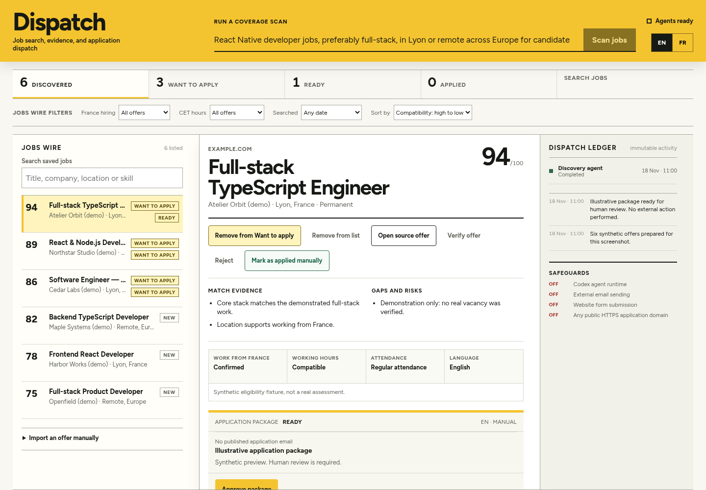

# Bonjour, je suis Philippe.

[English](README.md) · [Portfolio](https://www.webbyphil.net/) · [LinkedIn](https://www.linkedin.com/in/philippe-le-goff-35a12319a/) · [Email](mailto:webbyphil65@gmail.com)

Développeur full-stack basé à **Lyon**, avec plus de deux ans d’expérience professionnelle en développement logiciel. J’aime construire des produits utiles, comprendre les systèmes et partager mes connaissances avec une équipe.

Mon socle est **TypeScript, React, Node.js et MongoDB**. J’aime intégrer l’IA lorsque cela sert un usage concret : traiter des documents, retrouver une information, analyser un récit ou préparer un travail à valider par une personne.

## Projet principal : Dispatch

Une application personnelle Angular et TypeScript pour découvrir des offres, évaluer leur adéquation et préparer des candidatures factuelles. Les sources et décisions restent traçables ; les actions externes nécessitent une approbation explicite.

*Interface réelle, données fictives. Les recommandations sont illustratives ; aucune candidature n’a été envoyée.*

## Autres projets

- [Plotwise](https://github.com/PhilLeGoff/plotwise/blob/main/docs/CASE_STUDY.fr.md) : espace d’écriture avec analyse narrative, recherche sémantique et assistant IA. Projet collaboratif.
- [DocuScan AI](https://github.com/PhilLeGoff/docuscan-ai/blob/main/docs/CASE_STUDY.fr.md) : traitement documentaire, OCR, NLP et validation. Hackathon en équipe.
- [Reflexx](https://github.com/PhilLeGoff/reflexx/blob/main/docs/CASE_STUDY.fr.md) : plateforme de fidélité web/mobile/API, co-développée avec coordination de la feuille de route technique.
- [ShopNow+](https://github.com/PhilLeGoff/shopnow/blob/main/docs/CASE_STUDY.fr.md) : boutique et API TypeScript reliées à Kafka, Spark et HDFS. Projet académique.
- [TripExplorer](https://github.com/PhilLeGoff/tripexplorer/blob/main/docs/CASE_STUDY.fr.md) : découverte de lieux et organisation de voyages. Projet académique.

Je recherche des opportunités full-stack à **Lyon** ou à distance depuis la **France**. Je travaille en français et en anglais. J’utilise également Codex dans ma pratique de développement, distinctement des fonctionnalités IA intégrées aux produits.
