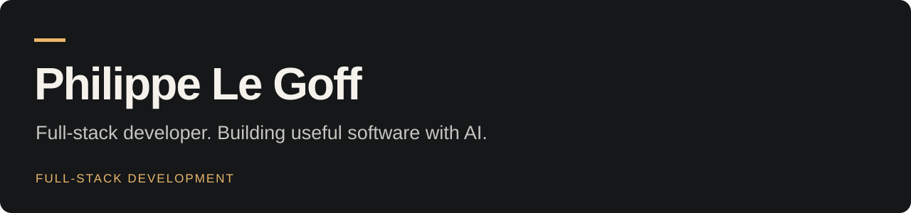
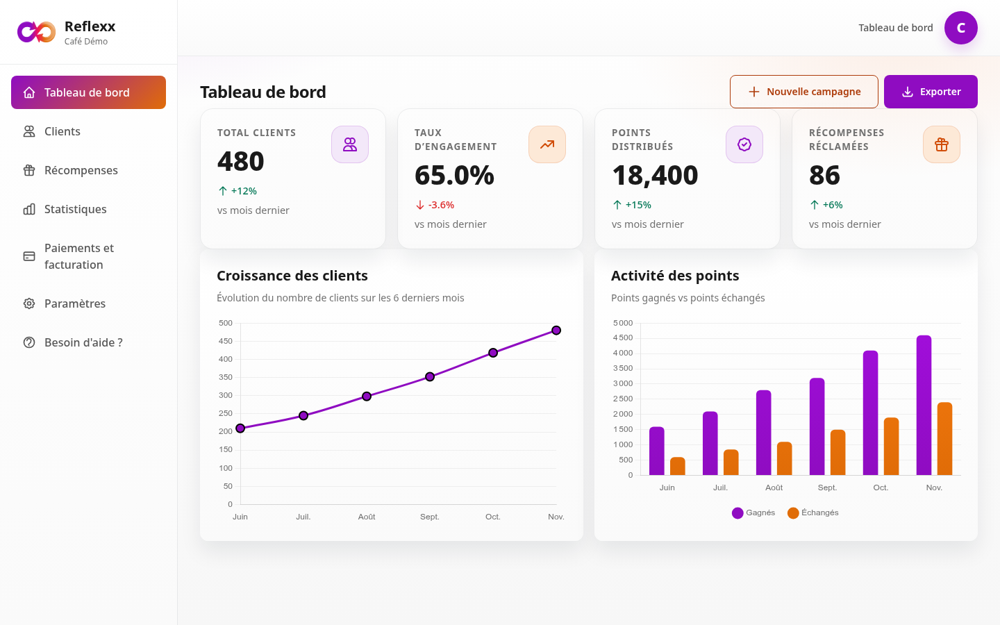
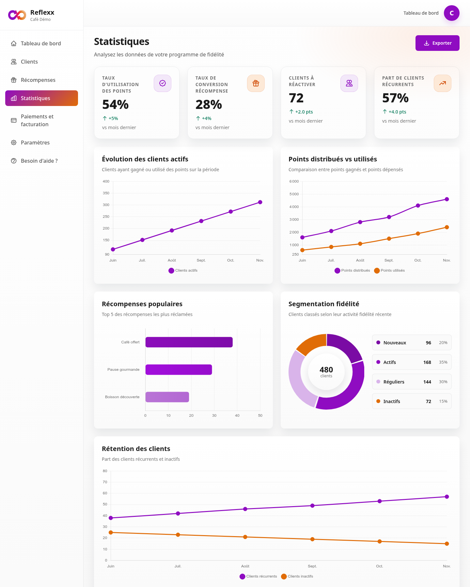

# Hi, I’m Philippe.

I’m a full-stack developer in **Lyon, France**, with more than two years of professional software-development experience. I enjoy building useful products, understanding how systems work, and sharing what I learn with a team.

My core stack is **TypeScript, React, Node.js and MongoDB**. I like integrating AI where it helps people get something done: processing documents, finding relevant information, understanding a manuscript, or preparing work for human review.

[Portfolio](https://www.webbyphil.net/) · [LinkedIn](https://www.linkedin.com/in/philippe-le-goff-35a12319a/) · [Email](mailto:webbyphil65@gmail.com) · [Français](README.fr.md)

## Featured: Reflexx

**A loyalty platform across web, mobile and API.**

I co-build Reflexx with two other engineers and coordinate the technical roadmap. Angular and Flutter interfaces connect to a TypeScript/Express API backed by Prisma and PostgreSQL, covering merchant programs, points and rewards.

Explore the loyalty statistics view

*Real dashboard captured locally with synthetic demonstration data. All displayed figures are illustrative.*

[Explore the case study →](https://github.com/PhilLeGoff/reflexx)

## Selected projects

| Project | What I worked on |
| --- | --- |
| [**Dispatch**](https://github.com/PhilLeGoff/dispatch) | A personal Angular and TypeScript application for AI-assisted offer discovery, factual document preparation and human review. |
| [**Plotwise**](https://github.com/PhilLeGoff/plotwise) | A manuscript workspace with source-linked narrative analysis, semantic retrieval and a streaming AI assistant. React, TypeScript, Fastify, MongoDB. Collaborative project. |
| [**DocuScan AI**](https://github.com/PhilLeGoff/docuscan-ai) | Document upload, OCR, NLP and validation connected to business workflows. React, FastAPI, MongoDB, Airflow. Team hackathon. |
| [**ShopNow+**](https://github.com/PhilLeGoff/shopnow) | A React storefront and TypeScript API connected to Kafka, Spark and HDFS. Academic project. |
| [**TripExplorer**](https://github.com/PhilLeGoff/tripexplorer) | Place discovery, saved trips and map-based planning. Next.js, TypeScript, Django and MongoDB. Academic project. |

## How I build

- **Interfaces:** React, Angular, React Native and Flutter.
- **APIs and data:** Node.js, Express, REST, MongoDB, PostgreSQL and Prisma.
- **AI integration:** document processing, structured extraction, embeddings, retrieval and streaming assistants, depending on the project.
- **Delivery:** Git, Docker, GitHub Actions, Jest and Playwright. I also use Codex as a development tool; that is separate from the AI features inside the products.

I’m open to full-stack opportunities in **Lyon** and remote roles that support working from **France**. French is my native language; I work professionally in English.
